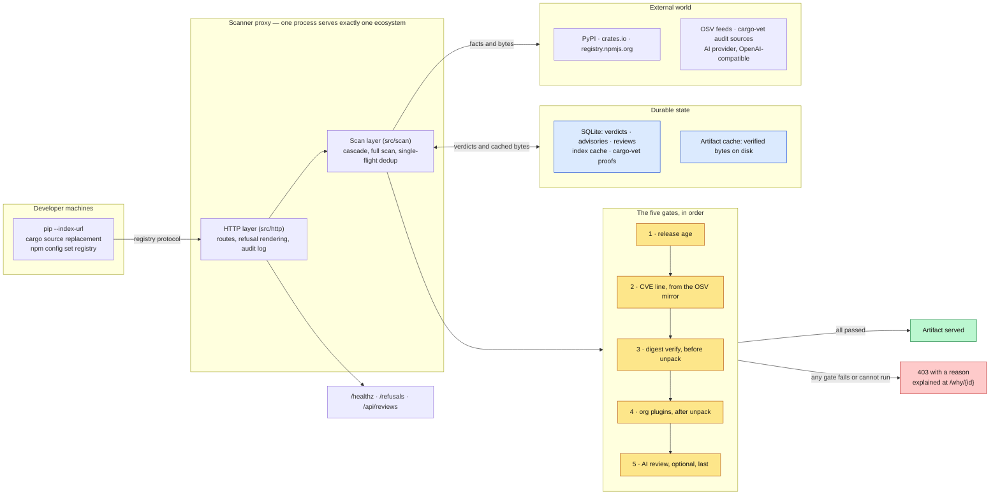

# Supply Chain Scanner

An HTTP proxy that sits in front of PyPI, crates.io or the npm registry, scans every package once, and refuses to serve anything that failed a check. See [`MISSION.md`](MISSION.md) for the problem statement.

- **The book** — read the full documentation at **<https://gvz.github.io/supply-chain-scanner/>**, published from `main` on every green CI run.
  The sources live in [`docs/book/`](docs/book/); build them locally with `mdbook build docs/book`. This repository pins rustc 1.88.0 and needs [mdbook](https://rust-lang.github.io/mdBook/) to build the book. If mdbook is not installed on your machine, install it with `cargo install mdbook`.
- **The design** — the approved spec and implementation plan live in `docs/superpowers/`.
- **The architecture** — editable draw.io diagrams of the system, the module layout, the per-ecosystem request flows, the data model and the startup sequence live in [`docs/diagrams/`](docs/diagrams/). Start with `01-system-overview.drawio`.
- **The API** — `cargo doc --open` renders the rustdoc, whose module docs double as short design notes.

## How it works

Nothing is installed on a developer's machine. Only the registry URL changes, so
`pip`, `cargo` and `npm` believe they are talking to the public registry — and
every artifact they ask for has to get past the gates first.



Every gate is **fail-closed**: a check that cannot run is *unverifiable*, never a
serve. The invariant everything else serves is that no artifact bytes reach a
developer unless release age, the CVE line, the digest, the org's plugins and the
AI review have all passed them — and every fetch and every withheld version is
recorded in the [audit log](https://gvz.github.io/supply-chain-scanner/audit-log.html)
with the client IP that asked.

The order above is the PyPI path, where one full scan runs all five gates. cargo
and npm reach the same verdict in two stages instead, because for them the index
response *is* the gate: a denied version is simply absent from it. The
[per-ecosystem flows](docs/diagrams/) show that in detail.

## Quick check of the code

```bash
cargo test && cargo clippy --all-targets -- -D warnings && cargo fmt --check
```

## Status

All three ecosystems serve traffic. A PyPI deployment answers the PEP 503 simple
index and artifact downloads; a cargo deployment answers the sparse index and
`.crate` downloads; an npm deployment answers the packument and tarball
downloads. One process serves exactly one ecosystem. Every fetch and every
withheld version is recorded in the [audit log](https://gvz.github.io/supply-chain-scanner/audit-log.html),
with the client address that asked.

CI runs the full gate on every push and pull request, builds `.deb` packages for
Debian 12 and 13 and Ubuntu 26.04 and 26.10, publishes the book, and — for each
of the three ecosystems — installs a real package from the real registry through
a proxy container, then asserts the install fails when the gate is configured to
refuse.

Known limitations, in rough order of how likely they are to matter:

- **`SIGHUP` configuration reload is a PyPI-path feature.** A cargo or npm
  deployment logs a warning at startup saying so; changing its configuration
  needs a restart.
- **The `.deb` packages carry no systemd unit and no service user**, and are
  built for amd64 only. They install the binary, the example configuration and
  the docs; wiring it up as a service is still the operator's job.
- **On cargo, a version whose publication date the registry omits is not
  age-checked.** A gate that cannot be evaluated at all now withholds the whole
  listing, but this one narrow case stays permissive — see the release-age
  section of [`docs/operations.md`](docs/operations.md) for why.

The [roadmap chapter](docs/book/src/roadmap.md) carries the full list: what is
built, what is deliberately not built, the known gaps inside what is built, and
where the documentation is still thin.