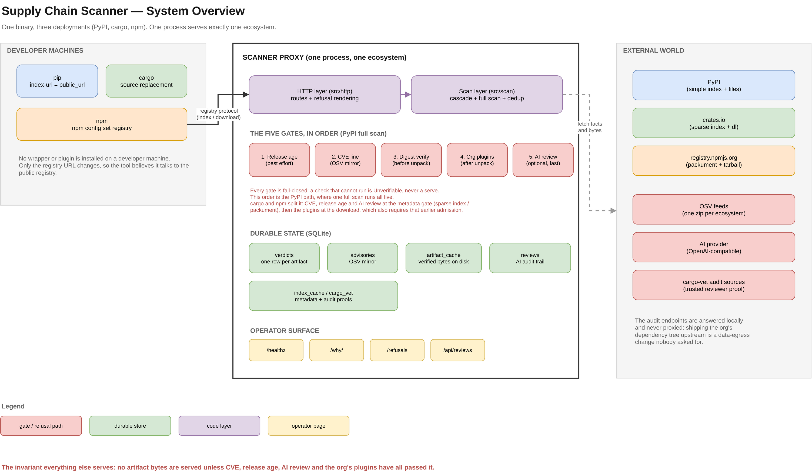
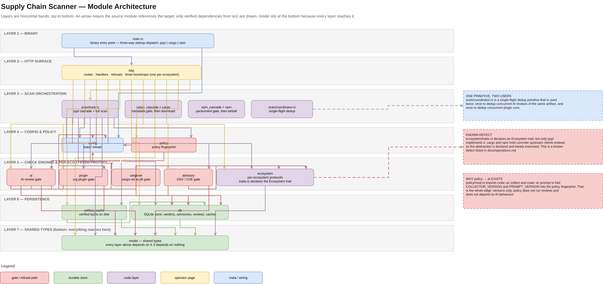
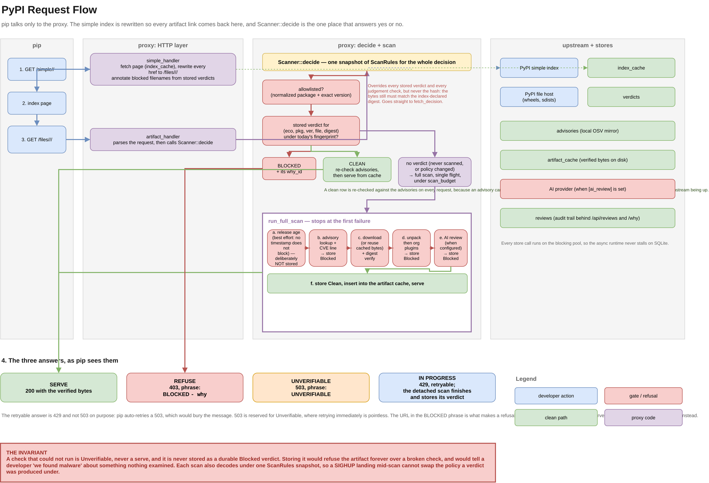
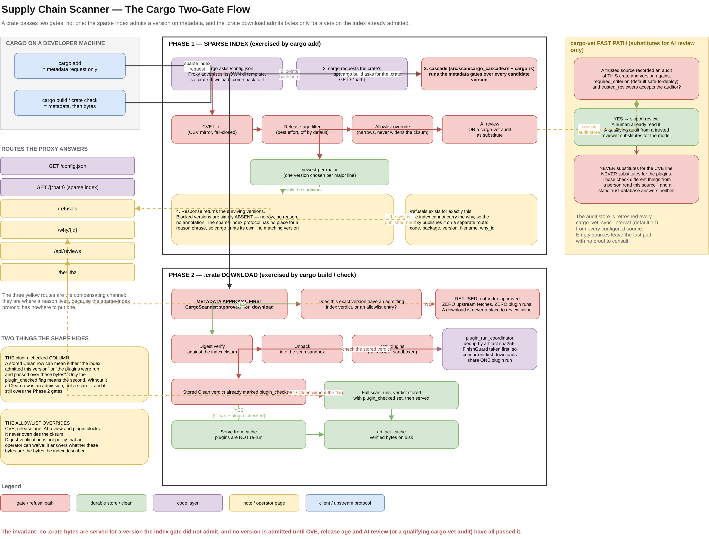
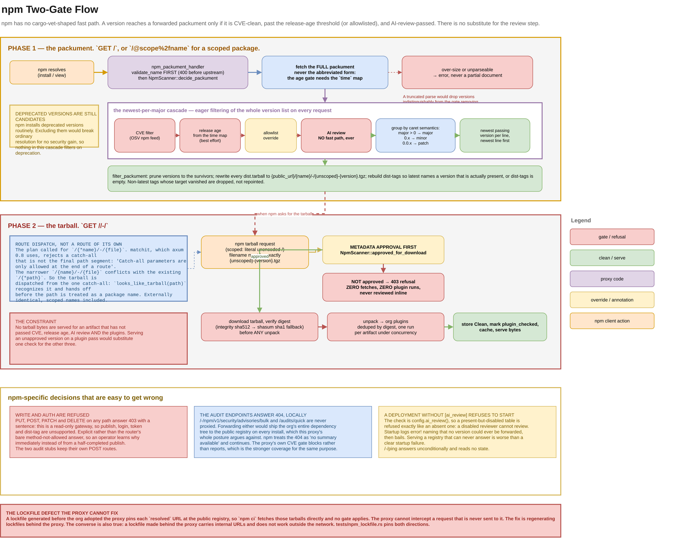
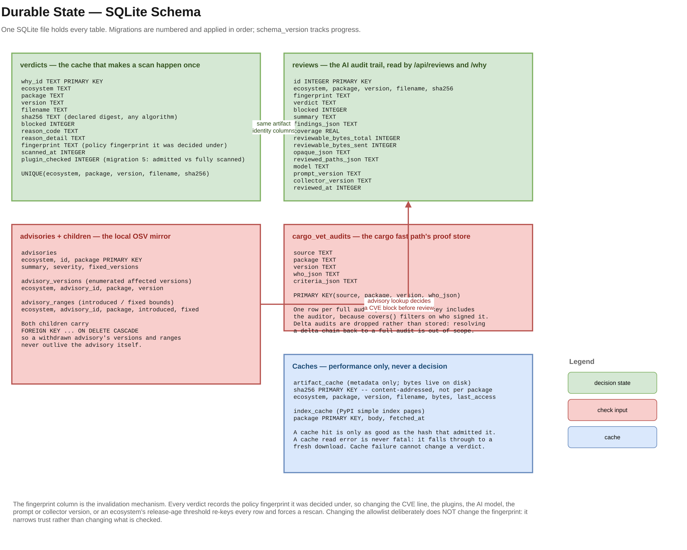
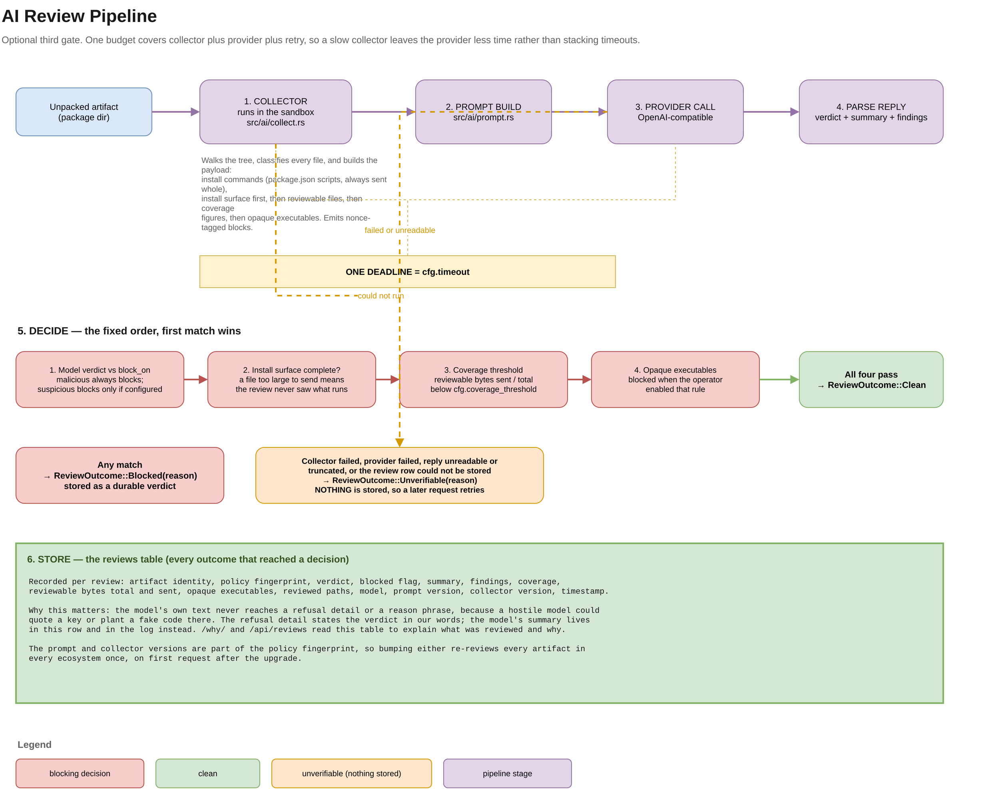
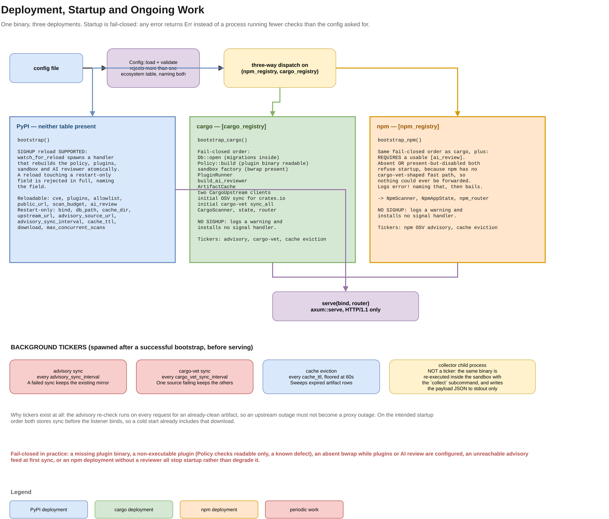

# Appendix D — Diagrams

Every architecture and flow diagram in one place. Each is a rendered PNG with
the editable draw.io source embedded inside the file, so it can be opened and
edited in [draw.io](https://app.diagrams.net). The `.drawio` source files and
the regeneration script live in [`docs/diagrams/`](../../diagrams/).

The diagrams are kept in step with the code, file by file. Where a diagram and a
chapter disagree, the code wins and the diagram is the thing to fix.

## 1. System overview

The whole system on one page: developer machines, the proxy's layers, the five
gates, durable state, the operator surface, and the external world. Start here.



## 2. Architecture and modules

The `src/` module dependency structure, layered from the binary down to
persistence, with the two structural gaps marked.



## 3. The PyPI request flow

The simple index, the artifact request, the verdict lookup, and the full-scan
gate order. See [The PyPI ecosystem](./pypi.md).



## 4. The cargo request flow

The cargo two-gate flow. The gates sit at different points in cargo's lifecycle:
the sparse index response, then the `.crate` download.



## 5. The npm request flow

The npm two-gate flow: the packument response, then the tarball download. Also
shows the route-dispatch constraint and the write refusal.



## 6. The data model

The SQLite schema: verdicts, reviews, the advisory mirror, cargo-vet proofs, and
the caches. See [Architecture](./architecture.md) for the store layout.



## 7. The AI review pipeline

The AI reviewer end to end: the collector, the prompt, the provider, reply
parsing, the fixed decision order, and what gets stored.



## 8. Deployment and startup

The three deployments, their fail-closed startup order, what each refuses to
start without, and the background tickers.



## Regenerating the renders

The `.drawio` file is the source of truth. After editing one, rebuild the PNGs
from the repository root:

```bash
./docs/diagrams/build-png.sh
cp docs/diagrams/png/*.png docs/book/src/diagrams/png/
```

The first command needs draw.io desktop (`drawio` on PATH) and `xvfb-run`,
because the export drives a headless Electron window. The second copies the
results where this book can serve them, since mdbook copies assets from `src/`
and will not follow a symlink out of it.

Faithful labels need the 2x export scale the script defaults to; a 1x render
makes the smaller box text unreadable at page width.
