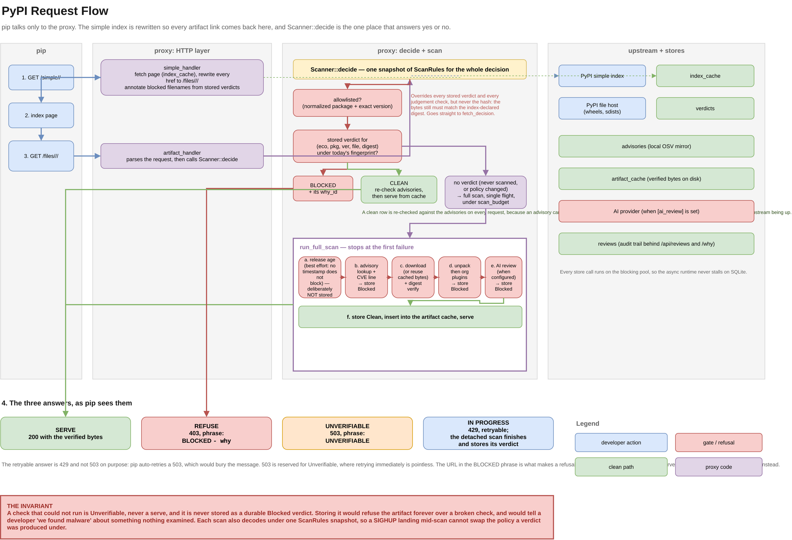

# The PyPI ecosystem

`src/ecosystem/pypi/` — everything that speaks PyPI's protocols. This is the code that later sits behind an `Ecosystem` trait so npm and cargo can be added without touching the rest of the system.

## The simple index (PEP 503)

`src/ecosystem/pypi/index.rs` parses and renders **PEP 503 "simple" index pages**: plain HTML, one `<a>` tag per artifact file.

An `IndexEntry` carries:

- `filename` — e.g. `demo-package-1.0.0-py3-none-any.whl`
- `url` — the absolute download URL from upstream
- `sha256` — parsed from the `#sha256=` URL fragment. `None` when the entry declares no hash
- `requires_python`, `metadata_hash`, `yanked` — passthrough metadata

Parsing is hand-written and strict: an unterminated tag, a missing `href`, or an empty filename text is an error, never a skipped artifact. An artifact that "parsed" to nothing would sail past every check.

### Name validation and normalization

Package names normalize per PEP 503: `[-_.]+` collapses to `-`, lowercased. `Flask_X`, `flask.x`, and `flask-x` are the same package.

`validate_package_name` rejects anything that is not a valid PyPI name outright — non-ASCII, separators in bad places, wrong length. This is the defense for names that arrive in HTTP paths: `../../etc` is a validation error, never a path.

### Filename parsing

`parse_filename` splits an artifact filename into package name and version (`demo-package-1.0.0-py3-none-any.whl` → `demo-package` / `1.0.0`). Returns `None` for a filename that does not carry both.

## The upstream client

`src/ecosystem/pypi/upstream.rs` — `Upstream` fetches index pages and downloads artifacts from the real PyPI.

Two jobs:

1. **`simple_page(package)`** — fetch the index page for one package, transparently backed by the durable `IndexCache` table. Upstream reachable → fetch fresh, store the body. Upstream unreachable → serve the last successfully fetched body, so a PyPI outage degrades to "serve what we already know" rather than an empty page.
2. **`download(entry, dest)`** — stream the artifact bytes to `dest` while hashing them with SHA-256, and return the computed hash. Streaming matters: the hash is computed as the bytes land, not by re-reading the file, so a multi-gigabyte artifact is never buffered in memory.

Timeouts are hard-coded and conservative: 5s connect, 10s per request. Timeouts on this path eat into the scan budget, so they cannot be generous.

## Fetched

`Fetched<T>` marks whether a value came from upstream (`Fresh`) or from the stale index cache (`Stale`). Callers such as the index re-check use it to decide whether the data is authoritative right now, versus a best-effort answer during an upstream outage.